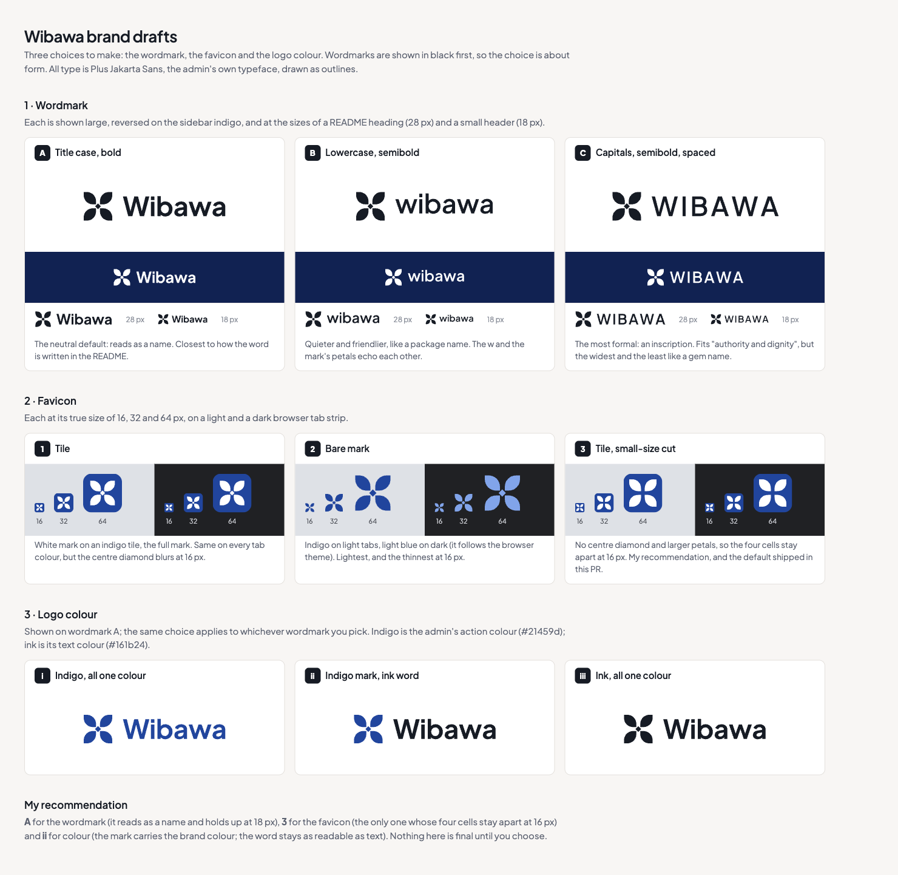

# Wibawa brand: drafts

**Status: draft, waiting for three choices.** Nothing here is final. `drafts.png` shows every option side by side.

## The choices

| Choice | Options | Recommended |
| --- | --- | --- |
| Wordmark | **A** title case, bold · **B** lowercase, semibold · **C** capitals, semibold, spaced | A |
| Favicon | **1** tile, full mark · **2** bare mark, follows the browser theme · **3** tile, small-size cut | 3 |
| Logo colour | **i** indigo throughout · **ii** indigo mark, ink word · **iii** ink throughout | ii |

Why: A reads as a name and holds up at 18 px. Favicon 3 is the only one whose four cells stay apart at 16 px; the full mark's centre diamond blurs there. With colour ii the mark carries the brand colour while the word stays as readable as text.

Until a choice is made, the admin ships favicon 3 (`app/assets/builds/wibawa/favicon.svg`), and the README keeps the plain mark it already had.

## Files

| File | What |
| --- | --- |
| `wordmark-a-title.svg`, `wordmark-b-lower.svg`, `wordmark-c-caps.svg` | The three lockups: mark plus word, black, type drawn as outlines |
| `favicon-tile.svg`, `favicon-bare.svg`, `favicon-small.svg` | The three favicon options |
| `outline.py` | Draws the wordmarks from the Plus Jakarta Sans file in the gem (`pip install fonttools brotli`) |
| `../logo/wibawa-symbol.svg` | The mark alone (already chosen) |

## Draft usage guide

To be finished once the choices are made. What is already settled:

**The mark.** *Kawung*, a batik motif once reserved for the Javanese courts, drawn as four table cells around one point. It stands for the admin's subject (tables of records) and its name (authority, dignity).

**Lockup.** The mark sits left of the word. The word's capitals are 5/8 of the mark's height and centred on it. The gap between them is 72 units of the mark's 256: its central diamond plus the margin on each side. The parts are never rearranged or resized against each other.

**Clear space.** Keep an empty zone around the logo equal to the width of the mark's central diamond (48 of 256 units, about a fifth of the mark's height) on every side. It scales with the logo.

**Minimum size.** The lockup: 18 px tall on screen. The mark alone: 16 px, using the small-size cut (favicon 3). The full mark with its diamond: 24 px or larger.

**Colour.**

| Name | Hex | Use |
| --- | --- | --- |
| Indigo (*wedel*) | `#21459d` | The mark; the admin's action colour |
| Deep indigo | `#112252` | The sidebar; a dark ground for the white logo |
| Ink | `#161b24` | The word; text |
| Canvas | `#f8f6f4` | A light ground |

Approved pairs: colour or black on white or canvas; white on indigo or deep indigo. On a photograph, put the white or black logo on a calm area.

**Typeface.** Plus Jakarta Sans (SIL Open Font License, which allows use in a logo), drawn by Tokotype in Jakarta. In the logo files it is outlines, so no font is needed to show them.

**Don't.** Stretch or squash it. Recolour it outside the table above. Rotate it. Add a shadow, outline or gradient. Retype the word in another typeface. Put it on a busy background.

**Still open.** Stacked and word-only lockups, PNG exports, and a trademark search on the name and the mark, none of which has been done.
